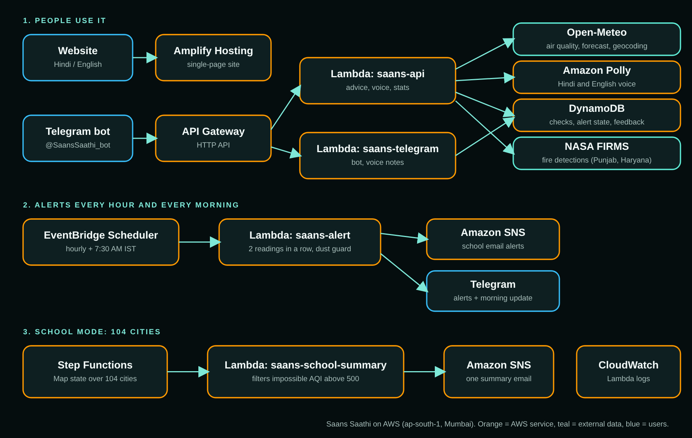

# Saans Saathi (सांस साथी)

Hindi and English air-quality advisory for people who work outdoors in India: delivery riders, street vendors, teachers, parents.
Built solo for the WeMakeDevs x AWS **Bharat Builds Tour, Event 02: Environmental Hacks**, Air track.

**Live site:** https://staging.d19gh0lcd3h85t.amplifyapp.com
**Telegram bot:** https://t.me/SaansSaathi_bot

## The problem
Air apps show a number (AQI) but not what to do. A rider in Delhi still has to guess: is it safe to work today, for how long, which mask, and when is the better time?

## What it does
- Search any Indian city (live autocomplete) or use your location.
- Shows live AQI, PM2.5, PM10, approximate CPCB AQI and GRAP stage.
- Gives advice by role (rider, vendor, teacher, parent) and health profile: safe time outside, mask, best time of day, tomorrow's warning.
- English and Hindi, with a female spoken voice (Amazon Polly).
- Telegram bot: city name or location, /compare, voice replies, alert subscription, 7:30 AM morning update.
- Hourly alerts. School email only after two consecutive readings above US AQI 150, with a dust-spike guard.
- School Mode: a Step Functions workflow checks 104 cities and emails a summary to schools. Impossible values (AQI above 500) are filtered and listed separately.
- Impact numbers and a Punjab/Haryana fire card (NASA FIRMS satellite detections).

## Architecture (all in ap-south-1, Mumbai)

## AWS services used
Amplify Hosting, API Gateway (HTTP API), Lambda (Python 3.12), DynamoDB, EventBridge Scheduler, SNS, Amazon Polly, Step Functions, CloudWatch.

## Repo layout
- `frontend/` single-file site (HTML, CSS, vanilla JS)
- `backend/saans-api/` air check, advice, voice, stats, fires
- `backend/saans-telegram/` Telegram bot
- `backend/saans-alert/` hourly and morning alerts
- `backend/saans-school-summary/` Step Functions summary step
- `stepfunctions/` the 104-city input

## Honest notes
- Air data is a model estimate from Open-Meteo (about 11 km grid), not a ground station. Small towns are approximate.
- Advice is rule-based. It is not medical advice and not a government order. GRAP stages are approximate.
- Amazon Bedrock was configured but blocked at account level, so the project does not claim AI advice.
- The fire card shows satellite fire detections, not a cause of today's AQI.
- Impact numbers include the builder's own test checks.

## Deploy
Each folder in `backend/` is one Lambda (Python 3.12). Telegram needs env vars `BOT_TOKEN` and `WEBHOOK_SECRET`; the fires route needs a free NASA FIRMS key. No secrets are stored in this repo. The site is uploaded to Amplify as a zip.
